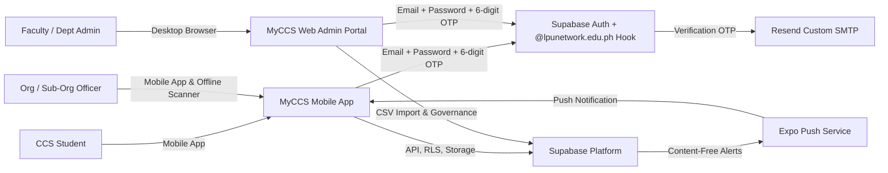
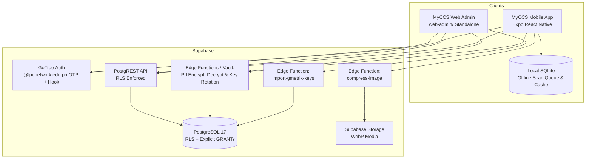

# MyCCS Software Architecture Baseline (SAB) — SCRUM-9

* **Version:** 2.0
* **Status:** Updated — Reconciled with PRD & Delivery Specs
* **Methodology:** Agile Scrum
* **Document Type:** Software Architecture Document
* **Primary Author:** Alexis John L. Rellon
* **Last Updated:** 2026-11-22
* **Related Specifications:**
  * [Product Requirements Document (`PRD_MyCCS.md`)](./PRD_MyCCS.md)
  * [Agile Project Brief](./College%20Department%20App%20-%20Agile%20Project%20Brief_Proposal.md)
  * [CI/CD Pipeline Specification](./CI_CD%20Pipeline%20Specification_%20Centralized%20Department%20Mobile%20App.md)
  * [Git Branching & Version Control Strategy](./Git%20Branching%20%26%20Version%20Control%20Strategy.md)

---

## Document Information & Approval

| Attribute | Details |
| :--- | :--- |
| **Document Title** | Software Architecture Baseline (SAB) |
| **Project Name** | MyCCS (Mobile App + Standalone `web-admin/` Portal) |
| **Jira Reference** | `SCRUM-9` |
| **Primary Author** | Alexis John L. Rellon |
| **Repository** | GitHub (Documentation as Code — single authoritative `.md` source) |

| Reviewer | Role | Decision | Date |
| :--- | :--- | :--- | :--- |
| Project Manager | Architecture Reviewer | Pending | |
| Technical Adviser | Technical Reviewer | Pending | |
| Development Team | Implementation Review | Pending | |

---

## 1. Executive Summary & Architecture Vision

MyCCS is the centralized digital platform for the College of Information Technology and Computer Science (CCS), which offers Information Technology (IT), Computer Science (CS), and Library and Information Science (LIS). It replaces fragmented social media notices, manual attendance sheets, ad-hoc survey tools, and spreadsheet-based certification key distribution with two coordinated applications sharing a single Supabase backend:

1. **MyCCS Mobile App (Expo React Native + TypeScript):** Used by CCS students and organization/sub-organization officers for department info, org pages, announcements, onsite/online events, offline-first QR attendance, conditional forms/evaluations, certification listings, and in-app GMetrix key viewing.
2. **MyCCS Web Admin Portal (`web-admin/`):** A standalone Vite + React + TypeScript SPA in its own repository directory (excluded from the mobile bundle and deployed independently to **Cloudflare Pages** with zero backend secrets on Cloudflare) prioritized for faculty/admin GMetrix CSV key distribution, faculty admin promotion, and department governance.

### Core Architectural Principles
1. **Security by Default & Least Privilege:** The client is never trusted. Every table enforces PostgreSQL Row Level Security (RLS) plus explicit `GRANT` statements; privileged writes run inside JWT-verified Supabase Edge Functions.
2. **Privacy by Design (RA 10173):** Student PII (`email`, `full_name`, `student_id`) and GMetrix `key_code` values are encrypted at rest with periodic key rotation (`key_version`). `student_id` is kept private and never exposed in QR codes or CSV imports.
3. **Offline-First Onsite Attendance:** Officers can scan student permanent QR codes with zero venue internet, queuing immutable scan events in local SQLite for automatic reconciliation when connectivity returns.
4. **Documentation as Code (SSOT):** This SAB owns technical architecture, schema, security, and ADRs. Product scope lives in [PRD_MyCCS.md](./PRD_MyCCS.md), CI/CD gates in [CI_CD Pipeline Specification](./CI_CD%20Pipeline%20Specification_%20Centralized%20Department%20Mobile%20App.md), and Git workflow in [Git Branching & Version Control Strategy](./Git%20Branching%20%26%20Version%20Control%20Strategy.md).

---

## 2. Technology Stack

| Layer | Technology | Purpose |
| :--- | :--- | :--- |
| **Mobile App** | React Native + Expo (TypeScript, strict mode) | Cross-platform Android/iOS client (root workspace) |
| **Mobile Navigation / State** | Expo Router, Zustand, Zod | File-based routing, global session state, runtime validation |
| **Local Offline Store** | Expo SQLite (`expo-sqlite`) | Offline attendance scan queue, pre-synced event config & roster cache |
| **Web Admin Portal** | Standalone Vite + React + TypeScript SPA (`web-admin/`) | Faculty CSV key distribution & admin governance; deployed independently to **Cloudflare Pages** |
| **Shared Contracts** | `shared/` directory | Shared TypeScript types and Zod schemas (form builder, CSV validation, DTOs) |
| **Backend Platform** | Supabase (PostgreSQL 17, GoTrue Auth, Storage, Deno 2 Edge Functions) | Primary relational DB, verified `@lpunetwork.edu.ph` Email/Password/OTP Auth, encrypted storage, trusted backend functions |
| **Transactional Email / SMTP** | Resend (Supabase Custom SMTP) | Delivers 6-digit `@lpunetwork.edu.ph` signup verification OTPs with SPF/DKIM deliverability |
| **Push Notifications** | Expo Push Service | Content-free alerts notifying students when GMetrix keys are ready |
| **Media Processing** | `expo-image-manipulator` + `compress-image` Edge Function | On-device pre-compression + server-side EXIF stripping and WebP normalization |

---

## 3. System Context & Container Architecture

### 3.1 System Context

### 3.2 Container Architecture

### 3.3 Monorepo Separation Boundary
* Root workspace (`/`): Expo mobile app. Metro/EAS build configuration must strictly ignore `web-admin/`.
* `web-admin/`: Standalone Vite + React SPA configured manually as the root directory on Cloudflare Pages (zero backend secrets on Cloudflare).
* `shared/`: Pure TypeScript types and Zod schemas imported by both clients and Edge Functions.
* `supabase/`: SQL migrations (`supabase/migrations/`) and Deno Edge Functions (`supabase/functions/`).

---

## 4. Domain Architecture

| Domain | Core Responsibilities |
| :--- | :--- |
| **Authentication & Identity** | Verified `@lpunetwork.edu.ph` Email + Password + 6-digit OTP (server-side `before-user-created` Auth Hook + Resend SMTP), JWT sessions, profile provisioning, opaque permanent QR token issuance. |
| **Department Info** | CCS "About the Department" content (overview, mission/vision, faculty directory, contacts) managed by `admin`. |
| **Organization & Sub-Org** | Two-tier hierarchy (`College Dept -> Main Org -> Sub-Org`), simplified Facebook-Page-style org pages (cover, logo, details, posts), officer scoping, membership applications. |
| **Announcements** | Department-wide and org/sub-org posts with visibility scoping and optional `expires_at` TTL. |
| **Events** | Onsite (`qr` attendance with configurable windows/cooldown/auto-checkout) and online (validated Zoom/Meet/Teams URLs) event lifecycles and registration capacity. |
| **Attendance & Offline Sync** | Offline-first officer scanning of permanent student QR tokens into SQLite, pre-event clock offset sync, check-in/check-out reconciliation, and automated checkout timeout. |
| **Forms & Evaluations** | Bounded conditional form builder (Zod JSONB schema: 4 field types + 1-level `visibleIf`), membership applications, post-event evaluations, and host evaluation metrics RPC. |
| **Certifications & GMetrix Keys** | Certification directory listings, Web Admin CSV key batch upload (`import-gmetrix-keys`), encrypted key storage, rejected-row CSV fallback, and student "My Keys" retrieval. |
| **Notifications** | In-app notification inbox and content-free Expo Push delivery (`push_tokens`). |

---

## 5. Authorization Architecture (RBAC)

MyCCS enforces a **3-role RBAC model** (`student | officer | admin`) via JWT claims, `org_memberships`, and PostgreSQL RLS. Faculty operate under the `admin` role.

| Capability | `student` | `officer` (scoped to assigned org/sub-org) | `admin` (Faculty & Dept) |
| :--- | :---: | :---: | :---: |
| View Dept About, Org/Sub-Org pages, Events, Certifications | ✓ | ✓ | ✓ |
| Apply to Orgs/Sub-Orgs, Register for Events, Submit Evaluations | ✓ | ✓ | ✓ |
| Display Permanent Personal QR & View Own GMetrix Keys | ✓ | ✓ | ✓ |
| Customize Assigned Org/Sub-Org Page & Publish Org Posts | X | ✓ | ✓ |
| Build Conditional Forms (Membership & Post-Event) & View Metrics | X | ✓ | ✓ |
| Create Events & Run Offline Officer QR Attendance Scanner | X | ✓ | ✓ |
| Manage Dept About, Main Orgs, Certifications & Upload GMetrix CSV | X | X | ✓ |

### Sub-Organization Governance
* `organizations.parent_org_id IS NULL` denotes a **Main Organization** under CCS.
* `organizations.parent_org_id` referencing a Main Org denotes a **Sub-Organization** operating as a separate entity under that Main Org.

---

## 6. Database Architecture (Unified ERD)

### 6.1 Database Conventions
* **UUID Primary Keys** on all entities.
* **Soft Deletes (`deleted_at TIMESTAMP NULL`)** on business-critical entities (`profiles`, `organizations`, `events`, `announcements`).
* **Explicit Grants + RLS:** Because `auto_expose_new_tables` is unset in `supabase/config.toml`, every migration creating a `public` table must enable RLS **and** issue explicit `GRANT` statements for `authenticated`.

### 6.2 Entity Relationship Diagram

```mermaid
erDiagram
    PROFILES {
        uuid id PK
        bytea student_id_enc
        bytea full_name_enc
        bytea email_enc
        text email_blind_index UK
        int key_version
        text qr_token UK
        text role "student | officer | admin"
        timestamptz created_at
        timestamptz updated_at
        timestamptz deleted_at
    }

    DEPARTMENT_INFO {
        uuid id PK
        text title
        text about_markdown
        jsonb leadership_json
        jsonb contact_json
        timestamptz updated_at
    }

    ORGANIZATIONS {
        uuid id PK
        uuid parent_org_id FK "NULL = Main Org"
        text name
        text details
        text logo_url
        text cover_url
        timestamptz created_at
        timestamptz deleted_at
    }

    ORG_MEMBERSHIPS {
        uuid id PK
        uuid profile_id FK
        uuid organization_id FK
        text role "member | officer"
        text status "pending | approved | rejected"
        uuid submission_id FK
        timestamptz created_at
    }

    ANNOUNCEMENTS {
        uuid id PK
        uuid organization_id FK "NULL = Dept-wide"
        text title
        text content
        boolean global_visibility
        timestamptz published_at
        timestamptz expires_at
        timestamptz deleted_at
    }

    EVENTS {
        uuid id PK
        uuid organization_id FK
        text title
        text description
        text flyer_url
        text modality "onsite | online"
        text meeting_url
        int capacity
        timestamptz starts_at
        timestamptz ends_at
        int on_time_grace_mins
        int late_window_mins
        int cooldown_secs
        int auto_checkout_mins
        text status "draft | published | ongoing | completed | archived"
        timestamptz deleted_at
    }

    EVENT_REGISTRATIONS {
        uuid id PK
        uuid event_id FK
        uuid profile_id FK
        timestamptz registered_at
    }

    ATTENDANCE_SCANS {
        uuid client_scan_id PK
        uuid event_id FK
        uuid student_profile_id FK
        uuid scanned_by_officer_id FK
        timestamptz adjusted_scanned_at
        int clock_offset_ms
        timestamptz synced_at
    }

    ATTENDANCE_RECORDS {
        uuid id PK
        uuid event_id FK
        uuid student_profile_id FK
        timestamptz checked_in_at
        timestamptz checked_out_at
        text checkout_source "scan | auto | null"
        text status "present | late | absent"
    }

    FORMS {
        uuid id PK
        uuid organization_id FK
        uuid event_id FK "NULL for membership form"
        text form_type "membership | post_event"
        text title
        jsonb schema_json
        boolean is_active
        timestamptz created_at
    }

    FORM_SUBMISSIONS {
        uuid id PK
        uuid form_id FK
        uuid profile_id FK
        jsonb answers_json
        timestamptz submitted_at
    }

    CERTIFICATIONS {
        uuid id PK
        text title
        text provider
        text description
        boolean is_active
    }

    CERTIFICATION_KEY_BATCHES {
        uuid id PK
        uuid certification_id FK
        uuid uploaded_by_admin_id FK
        int total_rows
        int assigned_count
        int rejected_count
        timestamptz created_at
    }

    CERTIFICATION_KEYS {
        uuid id PK
        uuid batch_id FK
        uuid certification_id FK
        uuid student_profile_id FK
        bytea key_code_enc
        text key_code_hash UK
        int key_version
        timestamptz assigned_at
        timestamptz viewed_at
    }

    NOTIFICATIONS {
        uuid id PK
        uuid profile_id FK
        text type "gmetrix_key | org_application | event"
        text title
        text body
        text deep_link
        timestamptz read_at
        timestamptz created_at
    }

    PUSH_TOKENS {
        uuid id PK
        uuid profile_id FK
        text expo_push_token UK
        text platform
        timestamptz updated_at
    }

    ORGANIZATIONS ||--o{ ORGANIZATIONS : parent_of
    PROFILES ||--o{ ORG_MEMBERSHIPS : holds
    ORGANIZATIONS ||--o{ ORG_MEMBERSHIPS : has
    ORGANIZATIONS ||--o{ ANNOUNCEMENTS : publishes
    ORGANIZATIONS ||--o{ EVENTS : hosts
    EVENTS ||--o{ EVENT_REGISTRATIONS : receives
    PROFILES ||--o{ EVENT_REGISTRATIONS : registers
    EVENTS ||--o{ ATTENDANCE_SCANS : logs
    EVENTS ||--o{ ATTENDANCE_RECORDS : summarizes
    PROFILES ||--o{ ATTENDANCE_RECORDS : attends
    ORGANIZATIONS ||--o{ FORMS : owns
    EVENTS ||--o{ FORMS : evaluates
    FORMS ||--o{ FORM_SUBMISSIONS : collects
    PROFILES ||--o{ FORM_SUBMISSIONS : submits
    CERTIFICATIONS ||--o{ CERTIFICATION_KEY_BATCHES : imports
    CERTIFICATION_KEY_BATCHES ||--o{ CERTIFICATION_KEYS : contains
    PROFILES ||--o{ CERTIFICATION_KEYS : assigned_to
    PROFILES ||--o{ NOTIFICATIONS : receives
    PROFILES ||--o{ PUSH_TOKENS : registers
```

---

## 7. Core Workflows

### 7.1 Offline-First Officer QR Attendance (Check-In, Check-Out & Auto-Checkout)

1. **Pre-Event Sync (While Online):** When an officer opens an onsite event, the app caches the event's `starts_at`, `on_time_grace_mins`, `late_window_mins`, `cooldown_secs`, `auto_checkout_mins`, a minimal display roster (for visual name verification), and computes `clock_offset_ms = server_now - device_now`.
2. **Permanent Personal QR Format:** Each student's permanent QR encodes an opaque signed token `v1.<profile_id>.<short_hmac>` — never raw `student_id`, `email`, or `full_name`.
3. **Offline Scanning:** With or without internet, the officer scans the student's QR. The app verifies the token signature locally, checks the local cooldown timer, stamps `adjusted_scanned_at = device_now + clock_offset_ms`, displays the student's name for visual anti-proxy verification, and inserts a row into local SQLite `attendance_scans` with an idempotent `client_scan_id` UUID.
4. **Automatic Sync & Reconciliation:** When connectivity returns, the background sync worker uploads pending `attendance_scans` in batches to Supabase. Server reconciliation materializes `attendance_records` idempotently across multiple officer devices:
   * Earliest valid scan sets `checked_in_at` and computes `status` (`present` within `starts_at + on_time_grace_mins`, `late` within `+ late_window_mins`, else `absent`).
   * Scans within `cooldown_secs` of the prior accepted scan are ignored.
   * A subsequent officer scan after cooldown sets `checked_out_at` with `checkout_source = 'scan'`.
   * If a checked-in student does not scan out within `auto_checkout_mins`, a scheduled backend job / server rule sets `checked_out_at` with `checkout_source = 'auto'`.
   * Large `clock_offset_ms` or extreme `synced_at - adjusted_scanned_at` skew is logged for audit.

### 7.2 Web Admin GMetrix CSV Key Distribution

1. Faculty (`admin` role) logs into `web-admin/` via verified `@lpunetwork.edu.ph` Email + Password and uploads a CSV mapping institutional email -> GMetrix key for a chosen certification.
2. `POST /functions/v1/import-gmetrix-keys` verifies the `admin` JWT, parses the CSV, normalizes each email (`trim().toLowerCase()`), and computes `email_blind_index = HMAC-SHA256(email, blind_index_key)`.
3. **Partial-Commit Processing:**
   * **Matched (registered student):** Encrypts `key_code`, inserts idempotently into `certification_keys` (`UNIQUE(key_code_hash)`), inserts a row in `notifications`, and queues a **content-free** Expo Push Notification (`"Your GMetrix certification key is ready. Open MyCCS to view it."` — raw key is never placed in push payloads).
   * **Unmatched (unregistered student) or Invalid/Duplicate Row:** Rejected without rolling back valid rows.
4. **Manual Fallback Report:** The Edge Function returns counts and a rejected-rows CSV (`row_number, email, reason`), sanitizing spreadsheet formula prefixes (`=`, `+`, `-`, `@`). The Web Admin UI prompts the professor to send those keys manually via email or MS Teams.

### 7.3 Media Upload & Image Compression (`compress-image`)
* Org cover images, logos, and event flyers are pre-compressed on-device (`expo-image-manipulator`, capped at 5 MB) and uploaded to `POST /functions/v1/compress-image`.
* The Edge Function validates the caller's JWT and role (`officer` or `admin`), strips EXIF metadata, normalizes to WebP, enforces MIME/size limits, and writes to Supabase Storage via the service role.

### 7.4 Conditional Form Builder & Host Evaluation Metrics
* `forms.schema_json` is validated by a shared Zod schema in `shared/` supporting 4 MVP field types (`short_text`, `single_choice`, `multi_choice`, `rating_1_5`) and 1-level equality visibility rules (`visibleIf: { fieldId, equals }`).
* Host metrics for post-event evaluations are computed by a PostgreSQL RPC/view aggregating response count, `rating_1_5` averages, and choice distributions—no separate analytics engine required.

---

## 8. Security, Data Privacy (RA 10173) & Encryption Strategy

1. **Encryption in Transit:** TLS 1.3 / HTTPS for all mobile, `web-admin/`, and Supabase communications.
2. **PII & Key Encryption at Rest:**
   * Sensitive fields (`profiles.email_enc`, `profiles.full_name_enc`, `profiles.student_id_enc`, `certification_keys.key_code_enc`) are encrypted via authenticated encryption (AEAD) managed through Supabase Vault / trusted Edge Functions. Encryption keys are never stored in mobile or web bundles.
   * **Keyed Blind Index for Lookups:** `profiles.email_blind_index` (HMAC-SHA256 using a dedicated backend pepper) enables O(1) exact-match lookups for GMetrix CSV imports without decrypting the `profiles` table.
   * **Periodic Key Rotation (`key_version`):** Encrypted tables track `key_version` so rotation jobs (90-day standard production keys; 30-day critical secrets) re-encrypt rows incrementally with zero downtime.
3. **Authentication Hardening:** `[auth.email] enable_signup = true` and `enable_confirmations = true` in `supabase/config.toml`; mandatory 6-digit email OTP verification via Resend custom SMTP; server-side `before-user-created` Auth Hook restricting signups strictly to `@lpunetwork.edu.ph`; SQL-seeded initial Department Admin(s) with in-app faculty promotion inside `web-admin/`; strict Edge Function CORS allowlist for the Cloudflare Pages origin; JWT tokens stored in Expo SecureStore (mobile) and PKCE session storage (`web-admin/`).
4. **Threat Mitigations:**
   * *QR Screenshot Sharing:* Visual name display on officer scanner + opaque signed token (no raw PII).
   * *Push Relay Leakage:* Raw GMetrix keys excluded from push payloads; retrieved only over authenticated RLS query.
   * *CSV Formula Injection:* Rejected-row exports escape leading `=`, `+`, `-`, `@`.

---

## 9. Engineering, Git & CI/CD Standards

* **TypeScript Strict Mode:** Enabled across root mobile app, `web-admin/`, and `shared/`.
* **Git Workflow & Atomic Commits:** Governed by [Git Branching & Version Control Strategy](./Git%20Branching%20%26%20Version%20Control%20Strategy.md) (`SCRUM-*` keys, `develop`/`main`, Squash & Merge, atomic client + `supabase/` commits).
* **CI/CD Pipeline:** Governed by [CI/CD Pipeline Specification](./CI_CD%20Pipeline%20Specification_%20Centralized%20Department%20Mobile%20App.md) (PR CI gates vs. post-merge `push` CD for EAS, `web-admin/`, and Supabase).

---

## 10. Architecture Decision Records (ADRs)

| ADR | Decision | Status | Rationale / Trade-off |
| :--- | :--- | :--- | :--- |
| **ADR-001** | Adopt React Native with Expo (TypeScript) | Accepted | Single mobile codebase with native camera, SQLite, and push support. |
| **ADR-002** | Adopt Supabase (PostgreSQL, Auth, Storage, Edge Functions) | Accepted | Rapid MVP delivery with RLS, `@lpunetwork.edu.ph` OTP Auth + Auth Hooks, and Deno backend functions. |
| **ADR-003** | Adopt PostgreSQL as Primary Database | Accepted | Strong relational integrity, JSONB support for forms, and native RLS. |
| **ADR-004** | Adopt Local SQLite for Offline Attendance Queue | Accepted | Guarantees zero-connectivity scan capture and reliable retry sync. |
| **ADR-005** | Adopt 3-Role RBAC (`student`, `officer`, `admin`) | Accepted | Keeps permission surface simple; faculty operate under `admin`. |
| **ADR-006** | Officer-Scanned Permanent Personal QR (Supersedes Rotating Event QR) | Accepted (Supersedes v1.0) | Rotating QRs break offline-first scanning; opaque signed permanent QR + visual name check + SQLite queue + cooldown + auto-checkout works fully offline. |
| **ADR-007** | Implement Privacy-by-Design (RA 10173) | Accepted | Keeps `student_id` private, strips EXIF via `compress-image`, excludes keys from push payloads. |
| **ADR-008** | Encrypt PII & GMetrix Keys with Blind Index & `key_version` Rotation | Accepted (Updated v2.0) | Satisfies strict PII security and 30/90-day rotation while preserving fast institutional-email CSV matching via HMAC-SHA256 blind index. |
| **ADR-009** | Isolate Web Admin as Standalone Vite + React SPA on Cloudflare Pages (`web-admin/`) | Accepted (Updated v2.1) | Excluded from mobile bundle; independently deployed to Cloudflare Pages with zero backend secrets on Cloudflare; shares types via `shared/`. |
| **ADR-010** | Bounded JSONB Conditional Form Builder & SQL Metrics RPC | Accepted | Delivers conditional membership/evaluation forms and host metrics within 4 sprints by capping MVP to 4 field types and 1-level `visibleIf` rules. |
| **ADR-011** | Verified `@lpunetwork.edu.ph` Email + Password + 6-Digit OTP Auth via Resend SMTP | Accepted | Direct University MS 365 IdP clearance is unavailable; mandatory signup OTP + server-side `before-user-created` domain hook proves institutional mailbox ownership while avoiding per-login SMTP burn and MS 365 Safe Links breaking magic links. |

---

## 11. Risk Register

| Risk | Probability | Impact | Mitigation |
| :--- | :---: | :---: | :--- |
| **Schedule overrun (2 devs / 4 sprints)** | High | High | Bound form builder to 4 types + 1-level branching; keep org pages read-only; share Zod schemas in `shared/`. |
| **Offline clock skew misclassifying attendance** | Medium | High | Record `clock_offset_ms` pre-event; store both `adjusted_scanned_at` and `synced_at`; flag large skew. |
| **Permanent QR proxy sharing** | Medium | Medium | Flash student's full name on officer scanner screen for visual check; require officer-led scanning. |
| **Key rotation breaking active queries** | Low | High | Dual-key `key_version` column + dedicated blind-index pepper with staged background re-encryption. |
| **Pre-merge CI deployment bug** | Medium | High | Split PR CI (`pull_request`) from production CD (`push` to `main`) in `.github/workflows/ci.yml`. |

---

## 12. Future Architecture Roadmap

* **Phase 1 (MVP):** Mobile App + Standalone `web-admin/` on Cloudflare Pages, Verified `@lpunetwork.edu.ph` Email/Password/OTP Auth (Resend SMTP + domain hook), Encrypted PII + Blind Index + Key Rotation, Dept About, Main/Sub-Org simplified pages, Onsite/Online Events, Offline Permanent-QR Check-In/Check-Out + Auto-Checkout, Bounded Conditional Forms & Host Metrics, GMetrix CSV Import + Content-Free Push/In-App Notifications.
* **Phase 2:** Automated email notifications for GMetrix keys, advanced analytics dashboards, multi-condition AND/OR form branching, student messaging.
* **Phase 3:** Multi-department and multi-campus expansion.

---

## 13. Acceptance Criteria & Definition of Done (`SCRUM-9`)

* [x] Architecture baseline reconciled with [PRD_MyCCS.md](./PRD_MyCCS.md), Agile Brief, CI/CD Spec, and Git Strategy
* [x] Unified ERD includes all MVP tables (`department_info`, sub-org hierarchy, `attendance_scans`, `attendance_records`, `forms`, `form_submissions`, `certification_keys`, `notifications`, `push_tokens`)
* [x] Offline attendance, GMetrix CSV distribution, PII encryption/blind index, and `web-admin/` separation fully specified
* [x] ADRs updated (`ADR-001` through `ADR-010`)
* [ ] Stakeholder review and sign-off by PM and Technical Adviser
